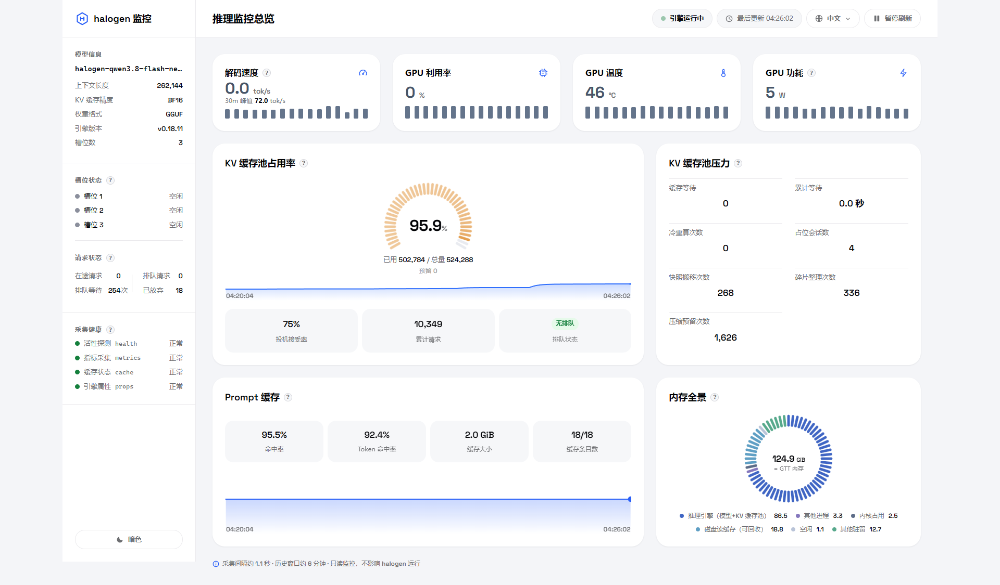
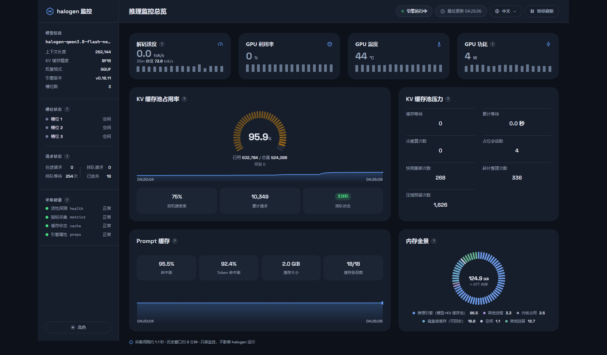

<!-- ⚠️ NAMING PENDING / 命名待定: the project name below is the placeholder `halogen-dashboard (working title)`. -->
<!-- Once the final name is decided, perform a GLOBAL replace across README.md / LICENSE / CONTRIBUTING.md. -->
<!-- 最终命名确定后，需将占位名在 README.md / LICENSE / CONTRIBUTING.md 中全局替换。 -->

# halogen-dashboard (working title)

> A single-file, read-only monitoring dashboard for a local [halogen] inference engine — GPU, memory, KV cache, slots, queueing and decode speed at a glance. No database, no build step, no agent on the engine.

*(halogen: the inference engine being monitored. Replace with a link once the engine's public name/repo is settled.)*

> 📷 **Screenshots below are placeholders** taken while the UI is being redesigned; they will be re-shot against the final release.
> 下方截图为 **UI 改版期间的占位图**，最终版发布前将重拍。

## Features

- **Single file** — the whole dashboard is one `dash.py` (Python 3 stdlib only, zero pip dependencies). Copy it next to your engine and run.
- **Read-only by design** — the dashboard only issues `GET` requests to the engine's status endpoints; it can never mutate engine state.
- **Live updates** — Server-Sent Events push (~1 s collection interval) with a ~30-minute history window; one-click pause.
- **Core metrics**: decode speed (tok/s, with 30-min peak), GPU utilization / temperature / power, KV-cache pool occupancy gauge, prompt-cache hit rates, memory panorama (engine vs. other processes vs. kernel vs. reclaimable), slot status, in-flight / queued / abandoned request counters.
- **Health strip** — per-collector status (health / metrics / cache / props) so you always know which numbers are stale.
- **4 languages** (简体中文 / English / 한국어 / Deutsch) × **light & dark themes**, persisted in `localStorage`.
- **Security-minded defaults** — see [Security design](#security-design).

## Screenshots

| Light | Dark |
|---|---|
|  |  |

Close-ups (zh-CN): [decode card](screenshots/close-decode-zh-light.png) · [sidebar](screenshots/close-sidebar-zh-light.png) · [KV gauge](screenshots/close-kv-gauge-zh-light.png) · [memory panorama](screenshots/close-pano-zh-light.png)

Full grid: `screenshots/` — `main-{zh-CN,en,ko,de}-{light,dark}.png` and `close-{decode,sidebar,kv-gauge,pano}-zh-{light,dark}.png`.

## Quick start

**Requirements**: Linux (metrics read `/proc` and `/sys`; GPU metrics need an AMD GPU with the `amdgpu` kernel driver — on other platforms the GPU/memory cards simply show as unavailable).

```bash
python3 dash.py
# then open http://127.0.0.1:8873
```

The dashboard expects the engine at `127.0.0.1:8899` (override with `DASH_ENGINE_URL`). If port 8873 is busy it automatically falls back through 8879 and prints the actual port on stdout.

Optional: put a `dash.config` (simple `KEY=VALUE` file) next to `dash.py` to override binds and the Host whitelist, e.g.:

```ini
DASH_BINDS=127.0.0.1,100.101.102.103
DASH_ALLOWED_HOSTS=my-host
```

Typical deployment: the dashboard runs on the same machine as the engine and is reached over **loopback** (`127.0.0.1:8873`) or over your **Tailscale** interface (e.g. `http://100.101.102.103:8873`). It by default never binds `0.0.0.0`.

## Security design

- **Binds only to loopback + your Tailscale IP** (configurable via `DASH_BINDS`); LAN interfaces refuse connections.
- **Host-header whitelist** — requests with an unexpected `Host` get **HTTP 421 Misdirected Request** (blocks DNS-rebinding style attacks).
- **`Server: dash`** — no framework/version disclosure; plus `X-Content-Type-Options: nosniff`, `X-Frame-Options: DENY`, `Referrer-Policy: no-referrer`.
- **No query logging** — the access log strips query strings.
- **Read-only** — engine endpoints are only ever `GET`-ed; the dashboard holds no write path to the engine.

## Metric FAQ

**Q: "Queued requests" vs "Cache waiting" — what's the difference?**
They are two different real metrics that used to share one name. **Queued requests** (sidebar) = `queued`: requests sitting in the engine's request queue, not yet admitted. **Cache waiting** (pressure card) = `cache_waiting_for_room`: requests already admitted but blocked waiting for KV-cache room to free up.

**Q: Used / Reserved / Total on the KV gauge — are they additive?**
No. **Reserved ⊄ Used**: *reserved* is the space *declared* by in-flight requests (prompt + max_tokens, including the not-yet-generated part); it is tracked independently and is **not** counted inside *used*. Only *used* and *total* drive the gauge arc; *reserved* is shown as a subordinate detail, not a third stacked segment.

**Q: What exactly is "decode speed"?**
A **real-time** figure: tokens/s over the most recent sampling window (not a since-start average), so it tracks what the engine is doing right now. The card's secondary value is the **max decode speed within the last 30 minutes**. Chart series are EMA-smoothed to tame jitter while keeping the real-time semantics. The value (and the 30-min peak) is clamped to a physical bandwidth ceiling of the local machine — by default **72 tok/s**, adjustable via `DASH_DECODE_CAP` (the dashboard serves the active cap to the UI automatically).

## Credits

- Bundled font: [Space Grotesk](https://github.com/floriankarsten/space-grotesk) © Florian Karsten, licensed under the **SIL Open Font License 1.1** (the font is embedded in `dash.py` as base64 `@font-face`). Full license text: [`docs/OFL-SpaceGrotesk.txt`](docs/OFL-SpaceGrotesk.txt).

## License

[MIT](LICENSE) — see [`LICENSE`](LICENSE).

---

# halogen-dashboard（工作名）

> 单文件、只读的本地 halogen 推理引擎监控仪表盘——GPU、内存、KV 缓存、槽位、排队与解码速度一目了然。无数据库、无构建步骤、引擎侧零探针。

## 特性

- **单文件**——整个仪表盘就是一个 `dash.py`（仅 Python 3 标准库，零 pip 依赖），放到引擎旁边即可运行。
- **只读设计**——仪表盘对引擎状态接口只发 `GET`，不存在任何修改引擎状态的路径。
- **实时刷新**——SSE 推送（采集间隔约 1 秒），约 30 分钟历史窗口，可一键暂停。
- **核心指标**：解码速度（tok/s，含 30 分钟峰值）、GPU 利用率/温度/功耗、KV 缓存池占用率仪表、Prompt 缓存命中率、内存全景（引擎/其他进程/内核/可回收）、槽位状态、在途/排队/已放弃请求计数。
- **采集健康条**——health / metrics / cache / props 四路采集器状态，一眼看出哪个数字过期了。
- **四语言**（简体中文 / English / 한국어 / Deutsch）× **明暗双主题**，偏好存 `localStorage`。
- **安全默认值**——见下文"安全设计"。

## 截图

见上方英文区同一组图片；全部文件在 `screenshots/` 目录。**注：UI 改版中，截图为占位，最终版将重拍。**

## 快速开始

**运行环境**：Linux（指标读取 `/proc`、`/sys`；GPU 指标需 AMD GPU + `amdgpu` 内核驱动，其他平台对应卡片显示为不可用）。

```bash
python3 dash.py
# 然后打开 http://127.0.0.1:8873
```

仪表盘默认访问 `127.0.0.1:8899` 上的引擎（可用 `DASH_ENGINE_URL` 修改）。若 8873 端口被占用，自动向后回退至 8879，并在控制台打印实际端口。

可选：在 `dash.py` 同放置放 `dash.config`（`KEY=VALUE` 纯文本）覆盖监听地址与 Host 白名单（如 `DASH_BINDS=127.0.0.1,100.101.102.103`、`DASH_ALLOWED_HOSTS=主机名…`）。典型部署：与引擎同机运行，经本机回环（`127.0.0.1:8873`）或 Tailscale 网卡（如 `http://100.101.102.103:8873`）访问，**默认绝不监听 0.0.0.0**。

## 安全设计

- **仅绑定回环 + Tailscale IP**（`DASH_BINDS` 可配），局域网接口拒连。
- **Host 白名单**——不匹配的请求直接返回 **HTTP 421**（防 DNS 重绑定）。
- **`Server: dash`**——不暴露框架/版本；另带 `nosniff`、`X-Frame-Options: DENY`、`Referrer-Policy: no-referrer`。
- **无查询日志**——访问日志剥离 query string。
- **只读**——对引擎端点只做 `GET`，无任何写路径。

## 指标口径 FAQ

**问：侧栏「排队请求」和压力卡「缓存等待」什么区别？**
两个真实指标，曾撞名后已拆分。**排队请求** = `queued`：在引擎请求队列中、尚未被接纳入队的请求；**缓存等待** = `cache_waiting_for_room`：已入队但正等待 KV 缓存腾出空间的请求。

**问：KV 仪表的 已用/预留/总量 能相加吗？**
不能。**预留与已用口径独立、不计入已用**：预留 = 在途请求声明的空间需求（prompt + max_tokens，含尚未生成的部分），与已用分别统计；只有"已用/总量"与仪表弧对应，预留是从属明细，不是第三段堆叠。

**问：解码速度是什么口径？**
**实时口径**：最近采样窗口的 tok/s（不是开机以来均值），反映引擎当下速度；卡片副值为 **30 分钟内最高解码速度**。走势图做 EMA 平滑抑制锯齿，但保持实时语义。峰值受本机带宽物理上限约束，默认封顶 72 tok/s，可用 `DASH_DECODE_CAP` 调整（封顶值自动下发给页面，无需两端改配置）。

## 致谢

- 内嵌字体：[Space Grotesk](https://github.com/floriankarsten/space-grotesk) © Florian Karsten，按 **SIL Open Font License 1.1** 授权（字体以 base64 `@font-face` 内嵌于 `dash.py`），许可全文见 [`docs/OFL-SpaceGrotesk.txt`](docs/OFL-SpaceGrotesk.txt)。

## 许可

[MIT](LICENSE)。
