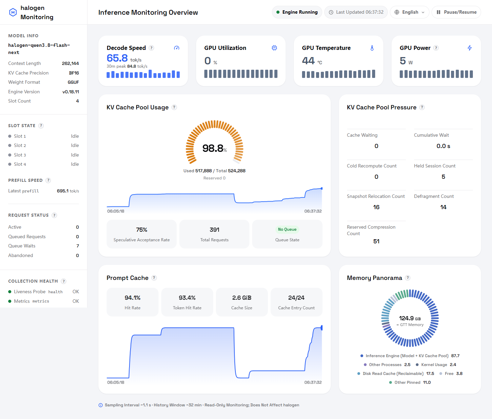

<!-- Working title: `halogen-dashboard`. Once the final name is decided, perform a GLOBAL replace -->
<!-- across README.md / README.zh-CN.md / LICENSE / CONTRIBUTING.md. -->

# halogen-dashboard (working title)

**English** | [简体中文](README.zh-CN.md)

> A single-file, read-only monitoring dashboard for a local [halogen] inference engine — GPU, memory, KV cache, slots, queueing and decode speed at a glance. No database, no build step, no agent on the engine.

*(halogen: the inference engine being monitored. Replace with a link once the engine's public name/repo is settled.)*

## Screenshots

[](screenshots/dashboard-dark.png)

Full-page view, light theme (1440 px wide). The image links to the [dark theme](screenshots/dashboard-dark.png) version of the same page.

## Features

- **Single file** — the whole dashboard is one `dash.py` (Python 3 stdlib only, zero pip dependencies). Copy it next to your engine and run.
- **Read-only by design** — the dashboard only issues `GET` requests to the engine's status endpoints; it can never mutate engine state.
- **Live updates** — Server-Sent Events push (~1 s collection interval) with a ~30-minute history window; one-click pause.
- **Core metrics**: decode speed (tok/s, with 30-min peak), prefill speed (most recent burst), GPU utilization / temperature / power, KV-cache pool occupancy gauge, prompt-cache hit rates, memory panorama (engine vs. other processes vs. kernel vs. reclaimable), slot state, and request status (active / queued / queue waits / abandoned).
- **Collection health strip** — per-collector status (health / metrics / cache / props) so you always know which numbers are stale.
- **4 languages** (Simplified Chinese / English / Korean / German) × **light & dark themes**, persisted in `localStorage`.
- **Security-minded defaults** — see [Security design](#security-design).

## Quick start

**Requirements**: Linux (metrics read `/proc` and `/sys`; GPU metrics need an AMD GPU with the `amdgpu` kernel driver — on other platforms the GPU/memory cards simply show as unavailable).

```bash
python3 dash.py
# then open http://127.0.0.1:8873
```

The dashboard expects the engine at `127.0.0.1:8899` (override with `DASH_ENGINE_URL`). If port 8873 is busy it automatically falls back through 8879 and prints the actual port on stdout.

### Configuration

All settings are environment variables. They can also live in an optional `dash.config` file (plain `KEY=VALUE` lines, `#` comments) next to `dash.py`; real environment variables take precedence.

| Variable | Default | Purpose |
|---|---|---|
| `DASH_ENGINE_URL` | `http://127.0.0.1:8899` | Engine base URL (accessed with `GET` only) |
| `DASH_ENGINE_PROC` | `flash_serve` | Engine process-name marker, used to attribute engine memory in the panorama |
| `DASH_BINDS` | `127.0.0.1` | Comma-separated bind addresses |
| `DASH_ALLOWED_HOSTS` | *(empty)* | Extra `Host` header whitelist entries (comma-separated); bound addresses are allowed automatically |
| `DASH_CONN_TIMEOUT` | `30` | Per-request timeout in seconds for engine polling |
| `DASH_MAX_CONNS` | `64` | Maximum simultaneous dashboard connections |

Example `dash.config`:

```ini
DASH_BINDS=127.0.0.1,100.101.102.103
DASH_ALLOWED_HOSTS=my-host
```

Typical deployment: the dashboard runs on the same machine as the engine and is reached over **loopback** (`127.0.0.1:8873`) or, with `DASH_BINDS` extended, over your **Tailscale** interface (e.g. `http://100.101.102.103:8873`). It by default never binds `0.0.0.0`.

## Security design

- **Binds to loopback only by default** (widened via `DASH_BINDS`); other interfaces refuse connections.
- **Host-header whitelist** — requests with an unexpected `Host` get **HTTP 421 Misdirected Request** (blocks DNS-rebinding style attacks).
- **`Server: dash`** — no framework/version disclosure; plus `X-Content-Type-Options: nosniff`, `X-Frame-Options: DENY`, `Referrer-Policy: no-referrer`.
- **No query logging** — the access log strips query strings.
- **Read-only** — engine endpoints are only ever `GET`-ed; the dashboard holds no write path to the engine.

## How speed is measured

Both speed figures are differences of counters the engine itself reports; the dashboard adds no estimation of its own.

- **Decode speed** = Δ(`tokens_predicted_total`) / Δ(wall clock) over a 15-second sliding window of active samples. There is no artificial cap. The engine advances the counter when requests complete, so the value holds its last window reading while a request is in flight and decays to 0 once the window slides empty (idle for more than 15 s). The card's secondary value is the maximum over the last 30 minutes.
- **Prefill speed** = Δ(`prompt_tokens_total`) / Δ(`prompt_seconds_total`) for the most recent prefill burst; the reading is held until the next burst starts.

## Metric FAQ

**Q: "Queued Requests" vs "Cache Waiting" — what's the difference?**
They are two different real metrics that used to share one name. **Queued Requests** (Request Status, sidebar) = `queued`: requests sitting in the engine's request queue, not yet admitted. **Cache Waiting** (pool pressure card) = `cache_waiting_for_room`: requests already admitted but blocked waiting for KV-cache room to free up.

**Q: Used / Reserved / Total on the KV gauge — are they additive?**
No. **Reserved is not a subset of Used**: *reserved* is the space *declared* by in-flight requests (prompt + max_tokens, including the not-yet-generated part); it is tracked independently and is **not** counted inside *used*. Only *used* and *total* drive the gauge arc; *reserved* is shown as a subordinate detail, not a third stacked segment.

## Credits

- Bundled font: [Space Grotesk](https://github.com/floriankarsten/space-grotesk) © Florian Karsten, licensed under the **SIL Open Font License 1.1** (the font is embedded in `dash.py` as base64 `@font-face`). Full license text: [`docs/OFL-SpaceGrotesk.txt`](docs/OFL-SpaceGrotesk.txt).

## License

[MIT](LICENSE) — see [`LICENSE`](LICENSE).
