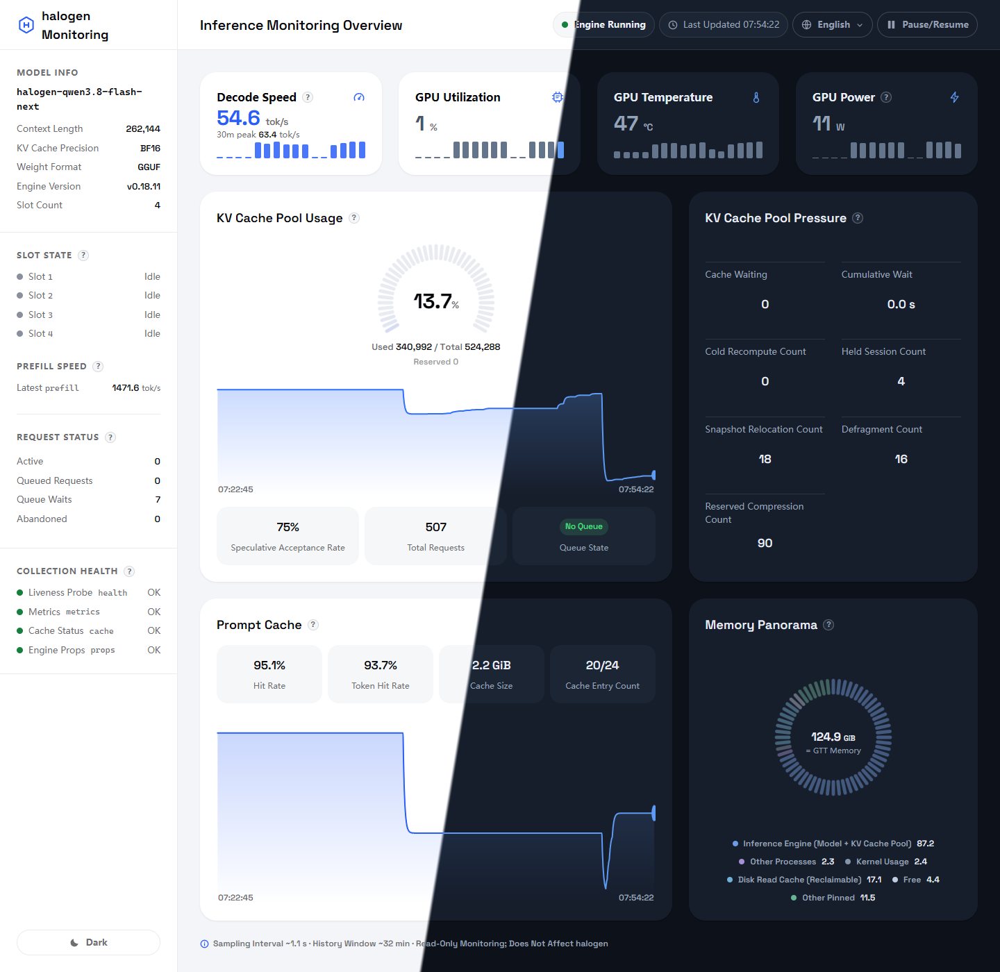

<!-- 工作名：`halogen-dashboard`。最终命名确定后，在 README.md / README.zh-CN.md / LICENSE / CONTRIBUTING.md 中全局替换。 -->

# halogen-dashboard

[English](README.md) | **简体中文**

> 单文件、只读的本地 halogen 推理引擎监控仪表盘——GPU、内存、KV 缓存、槽位、排队与解码速度一目了然。无数据库、无构建步骤、引擎侧零探针。

## 截图

[](screenshots/hero-split.png)

整页视图——左侧浅色主题、右侧深色主题（宽 1440 px），点击可查看原图。截图为英文界面；产品内置简体中文，可在页面右上角切换。

## 特性

- **单文件**——整个仪表盘就是一个 `dash.py`（仅 Python 3 标准库，零 pip 依赖），放到引擎旁边即可运行。
- **只读设计**——仪表盘对引擎状态接口只发 `GET`，不存在任何修改引擎状态的路径。
- **实时刷新**——SSE 推送（采集间隔约 1 秒），约 30 分钟历史窗口，可一键暂停。
- **核心指标**：解码速度（tok/s，含 30 分钟峰值）、预填充速度（最近一次突发）、GPU 利用率/温度/功耗、KV 缓存池占用率仪表、Prompt 缓存命中率、内存全景（引擎/其他进程/内核/可回收）、槽位状态、请求状态（处理中/排队请求/排队等待/已放弃）。
- **采集健康条**——health / metrics / cache / props 四路采集器状态，一眼看出哪个数字过期了。
- **四语言**（简体中文 / English / 한국어 / Deutsch）× **明暗双主题**，偏好存 `localStorage`。
- **安全默认值**——见下文"安全设计"。

## 快速开始

**运行环境**：Linux（指标读取 `/proc`、`/sys`；GPU 指标需 AMD GPU + `amdgpu` 内核驱动，其他平台对应卡片显示为不可用）。

```bash
python3 dash.py
# halogen-dash listening on http://127.0.0.1:8873
# 然后打开 http://127.0.0.1:8873
```

仪表盘默认访问 `127.0.0.1:8899` 上的引擎（可用 `DASH_ENGINE_URL` 修改）。若 8873 端口被占用，自动向后回退至 8879，并在控制台打印实际端口。

没有引擎也能看：打开 `http://127.0.0.1:8873/?demo=sleep`（或 `?demo=empty`）即可预览模型待命/空态界面。

### 配置

所有配置项均为环境变量；也可写入 `dash.py` 同目录的可选 `dash.config` 文件（`KEY=VALUE` 纯文本，`#` 注释），真实环境变量优先。

| 变量 | 默认值 | 用途 |
|---|---|---|
| `DASH_ENGINE_URL` | `http://127.0.0.1:8899` | 引擎地址（仅以 `GET` 访问） |
| `DASH_ENGINE_PROC` | `flash_serve` | 引擎进程名标记，用于内存全景中归属引擎内存 |
| `DASH_BINDS` | `127.0.0.1` | 逗号分隔的监听地址 |
| `DASH_ALLOWED_HOSTS` | *（空）* | `Host` 白名单补充项（逗号分隔）；已绑定地址自动放行（通配绑定除外——此时需显式设置 `DASH_ALLOWED_HOSTS`） |
| `DASH_CONN_TIMEOUT` | `30` | 仪表盘入站连接的单连接 socket 读写超时（秒，防 slowloris）；引擎轮询超时为代码内固定值（2–8 秒） |
| `DASH_MAX_CONNS` | `64` | 仪表盘最大并发连接数 |

`dash.config` 示例：

```ini
DASH_BINDS=127.0.0.1,100.101.102.103
DASH_ALLOWED_HOSTS=my-host
```

典型部署：与引擎同机运行，经本机回环（`127.0.0.1:8873`）访问；扩展 `DASH_BINDS` 后也可经 **Tailscale** 网卡访问（如 `http://100.101.102.103:8873`）。**默认绝不监听 0.0.0.0**。

## 安全设计

- **默认仅绑定回环**（用 `DASH_BINDS` 放宽），其他接口拒连。
- **Host 白名单**——不匹配的请求直接返回 **HTTP 421 Misdirected Request**（防 DNS 重绑定）。
- **`Server: dash`**——不暴露框架/版本；另带 `X-Content-Type-Options: nosniff`、`X-Frame-Options: DENY`、`Referrer-Policy: no-referrer`。
- **无查询日志**——访问日志剥离 query string。
- **只读**——对引擎端点只做 `GET`，无任何写路径。

## 速度指标口径

两个速度数字都是引擎自报计数器的差值，仪表盘不做任何自行估算。

- **解码速度** = 窗口内产出 token 总量 ÷ 纯生成耗时 × 并发度（15 秒滑动窗口，按完成拍聚合），无任何人为封顶。引擎在请求完成时推进计数器，因此生成进行中显示上一窗口值，空闲超过 15 秒（窗口滑空）后归零。卡片副值为最近 30 分钟内的最高值。
- **预填充速度** = Δ(`prompt_tokens_total`) / Δ(`prompt_seconds_total`)，对应最近一次 prefill 突发；突发结束后保持该值，直到下一次突发开始。

## 指标口径 FAQ

**问：侧栏「排队请求」和压力卡「缓存等待」什么区别？**
两个真实指标，曾撞名后已拆分。**排队请求**（侧栏"请求状态"）= `queued`：在引擎请求队列中、尚未被接纳入队的请求；**缓存等待**（池压力卡）= `cache_waiting_for_room`：已入队但正等待 KV 缓存腾出空间的请求。

**问：KV 仪表的 已用/预留/总量 能相加吗？**
不能。**预留与已用口径独立、不计入已用**：预留 = 在途请求声明的空间需求（prompt + max_tokens，含尚未生成的部分），与已用分别统计；只有"已用/总量"与仪表弧对应，预留是从属明细，不是第三段堆叠。

## 致谢

- 内嵌字体：[Space Grotesk](https://github.com/floriankarsten/space-grotesk) © Florian Karsten，按 **SIL Open Font License 1.1** 授权（字体以 base64 `@font-face` 内嵌于 `dash.py`），许可全文见 [`docs/OFL-SpaceGrotesk.txt`](docs/OFL-SpaceGrotesk.txt)。

## 许可

[MIT](LICENSE)——见 [`LICENSE`](LICENSE)。
